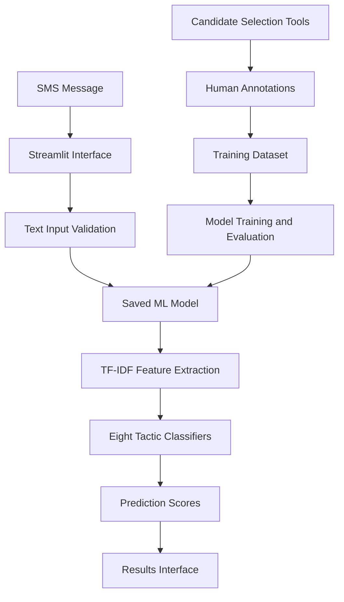

# 🛡️ ScamShield-AI
### Explainable Multi-Tactic SMS Social Engineering Analysis

ScamShield-AI is an experimental machine-learning project that analyzes SMS messages for potential social-engineering tactics. It uses TF-IDF text features and separate Logistic Regression classifiers to identify eight types of manipulative language.

The project includes a Streamlit interface for message analysis, a human annotation workflow, candidate-selection utilities, and an ML training pipeline.

> **Disclaimer:** ScamShield-AI is a research prototype, not a production fraud detector. Its scores are not calibrated probabilities. A message that is not flagged is not necessarily safe.

## ✨ Features

- **Eight tactic classifiers:** Analyze messages for authority, urgency, threat, fear, impersonation, credential requests, payment requests, and reward lures.
- **Interactive SMS analysis:** Enter a message in the Streamlit application and review the model's predictions.
- **Human annotation workflow:** Review messages and assign Yes, No, or Unknown labels for individual tactics.
- **Candidate selection:** Generate targeted annotation queues to help prioritize underrepresented tactics and review potential hard negatives.
- **Machine-learning pipeline:** Train and save a separate text classifier for each tactic.
- **Automated smoke tests:** Check model loading, prediction output structure, and representative-message handling.

## 🧠 Detection Tactics

| Tactic | Description |
|---|---|
| Authority | Language invoking institutional or official authority |
| Urgency | Pressure to act immediately |
| Threat | Threats of penalties, consequences, or harm |
| Fear | Language intended to create fear or anxiety |
| Impersonation | Potential deceptive representation of a person or organization |
| Credential request | Requests for passwords or other authentication information |
| Payment request | Requests to send money or make payments |
| Reward lure | Promises of prizes, rewards, or winnings |

These categories describe language patterns, not definitive proof of fraud. Some legitimate messages may contain similar language.

## 🏗️ Architecture



### Model pipeline

1. Collect and prepare SMS text and tactic labels.
2. Review messages using the annotation application.
3. Build the partially labeled training dataset.
4. Convert message text into TF-IDF features using unigrams and bigrams.
5. Fit individual Logistic Regression classifiers using class weighting.
6. Save the model artifact to `models/tfidf_multilabel_baseline.joblib`.
7. Load the saved model in the prediction interface.

Unknown labels are excluded from the corresponding tactic's supervised training data.

## 🧰 Technology Stack

- **Language:** Python
- **Machine learning:** scikit-learn, Logistic Regression, TF-IDF
- **Data processing:** pandas, NumPy
- **Model persistence:** joblib
- **User interface:** Streamlit
- **Testing:** pytest
- **Version control:** Git and GitHub

## 🚀 Getting Started

### Prerequisites

- Python installed
- Git
- A terminal such as PowerShell

### 1. Clone the repository

```bash
git clone https://github.com/ArtsWallah/ScamShield-AI.git
cd ScamShield-AI
```

### 2. Create and activate a virtual environment

On Windows PowerShell:

```powershell
python -m venv .venv
.\.venv\Scripts\Activate.ps1
```

### 3. Install dependencies

```powershell
python -m pip install -r requirements.txt
```

### 4. Launch the SMS analysis application

```powershell
python -m streamlit run streamlit_app.py
```

### 5. Launch the annotation application

Open a separate terminal, activate the environment, and run:

```powershell
python -m streamlit run src/annotation/app.py
```

### 6. Run the prediction CLI

```powershell
python src/ml/predict.py
```

### 7. Train the baseline model

```powershell
python src/ml/train_baseline.py
```

The training script reads `data/processed/final_training_data.csv` and writes the model artifact to `models/tfidf_multilabel_baseline.joblib`.

## 📊 Initial Evaluation

The baseline uses human-labeled examples for its reported cross-validation metrics. The training dataset also contains a small number of mixed or pseudo-labeled rows used during final model fitting.

| Tactic | Human-only CV F1 |
|---|---:|
| Authority | 0.667 |
| Urgency | 0.784 |
| Threat | Not evaluated |
| Fear | Not evaluated |
| Impersonation | 0.444 |
| Credential request | 0.500 |
| Payment request | 0.333 |
| Reward lure | 0.937 |

These are preliminary results from a small dataset, not estimates of real-world fraud detection accuracy. Threat and fear each had only one positive example in the current training dataset, so reliable evaluation was not possible.

The evaluation uses stratified cross-validation where the available class counts permit it. Results may be unstable because of the limited number of independently reviewed examples.

## 🧪 Tests

Run the prediction smoke tests:

```powershell
python -m pytest tests/test_scamshield_prediction.py -v
```

The current test suite checks model loading, the shape and validity of prediction outputs, and handling of representative messages.

Passing these tests demonstrates basic software functionality; it does not establish predictive accuracy.

## ⚠️ Limitations

- The human-labeled dataset is small and unevenly distributed across tactics.
- Rare tactics have insufficient positive examples for dependable predictions.
- Some ordinary messages may be flagged, while some malicious messages may be missed.
- Model scores are not calibrated fraud probabilities.
- Cross-validation results are preliminary and should not be treated as production performance.
- The prototype does not independently verify sender identity, URLs, bank transactions, or whether a payment actually occurred.

## 🔭 Future Improvements

- Collect and independently review more labeled messages, especially for threat, fear, and credential requests.
- Improve the quality and diversity of hard-negative examples.
- Evaluate on a separate, human-labeled test set.
- Measure per-tactic precision, recall, F1, and confusion matrices.
- Investigate threshold selection using validation data.
- Add more robust explanations and uncertainty handling.
- Assess generalization to new datasets and previously unseen scam patterns.

## 👨‍💻 Repository

**GitHub:** https://github.com/ArtsWallah/ScamShield-AI

ScamShield-AI is an experimental project intended for learning, research, and demonstration. It should not be used as the sole basis for financial or security decisions.